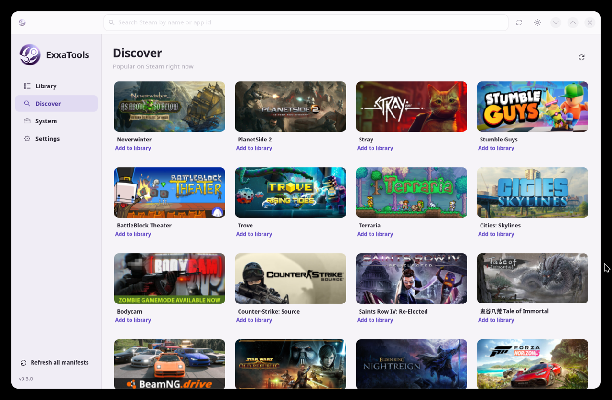

# ExxaTools

Steam depot and manifest manager for Linux, on
[Vapor Forge](https://github.com/Hintay/vapor-forge).

Pick a game, pin its depots and manifests, store depot keys — Steam downloads
it through the real CDN like any owned game.



Rust, one binary, native GTK4/libadwaita. The engine patch that keeps Vapor
Forge working on current Steam builds lives in
[`patches/vapor-forge/`](patches/vapor-forge/).

## Starts with Steam

Starting Steam starts ExxaTools — no scripts, no autostart, no background
loop. A wrapper around Steam's container launcher raises the API server on
`127.0.0.1:8765` and loads the shim into the client.

```sh
steam          # the server comes up by itself
./exxa window  # the dashboard
```

Inside Steam: an ExxaTools panel next to **Help**, a card on every store page,
and the dashboard as a native window (not a browser tab). The panel has quick
actions for Discover, manifest sync, plan repair, the provider and Steam
restart; each library game has Install, Sync, Launch and Fix update buttons.

## The dashboard

- **Library** — shelf, per-game inspector, depot table, plan details
- **Discover** — store grid, games only
- **System** — the Doctor's checks, each with its fix
- **Settings** — sources, keys, request-code mirrors

Two Nacre themes — graphite violet and light pearl — switched live from the
title bar.

## Daily commands

```sh
./exxa steam                  # start Steam with everything wired
./exxa window                 # open the dashboard
./exxa serve                  # just the API server
./exxa search "portal"        # find a game
./exxa plan fetch 620         # fetch keys + plan from a source
./exxa plan 730 --write       # write the Lua plan
./exxa pin 730 731 <gid>      # pin an older manifest
./exxa fix 620                # stop the update-required loop
./exxa doctor                 # twelve checks with fixes
./exxa diagnose               # name the failure in the Steam log
./exxa                        # usage JSON
```

## Where keys and codes come from

Steam will not hand out depot keys or request codes for apps you do not own:

- **Depot keys** — [Hubcap](https://hubcapmanifest.com) (free `smm_` key),
  pasted by hand, or any custom `{depotId}` source.
- **Request codes** — public mirrors plus your own, edited as one ordered
  list in Settings; saving rewrites the provider script and Vapor Forge
  hot-reloads it.
- **Manifests** — Hubcap's archive also carries depot manifest blobs, stored
  into Steam's `depotcache` so a pinned build mounts without a request code.

Plans land in `~/.config/vapor-forge/scripts/<appid>.lua` with keys and
pinned manifest ids; every state save keeps a backup of what was there.

```lua
addappid(730)
addappid(731, 1, "…64 hex…")              -- depot key
setmanifestid(731, "7643209663222864337")  -- pinned manifest
```

## Troubleshooting

| Symptom | Fix |
| --- | --- |
| No server on 8765 after a Steam update | `./exxa steam` once — it reinstalls the container wrapper |
| Game sticks in "update required" | `./exxa fix <appid>` |
| Download stalls on content servers | mirrors are rate limited — wait or add your own in Settings |
| Shim missing from the client | `exxa doctor` names the broken link in the chain |

## Build

```sh
cargo build --release
```

## Layout

```
src/         Rust: server, plans, providers, Steam control, GTK dashboard
patches/      the Steam-build patch for Vapor Forge
assets/       panel script, dashboard screenshot
web/          panel assets
packaging/    PKGBUILD
```

## License

MIT
