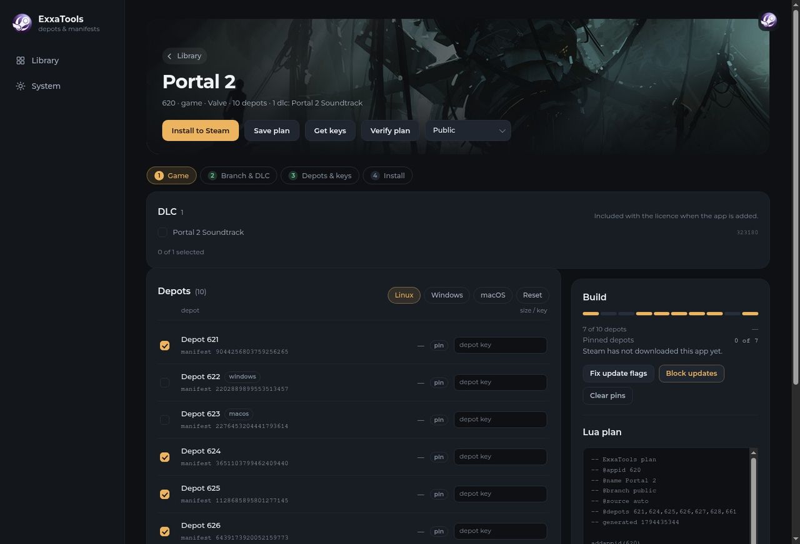

# ExxaTools

Manifest and depot manager for the Linux Steam client, driven by
[Vapor Forge](https://github.com/Hintay/vapor-forge).

It is the Linux answer to the Windows-style Lua app managers: pick an app,
choose its depots, pin manifests, store depot keys, and write a Lua plan into
Vapor Forge's script directory. Vapor Forge does the hooking and Steam does the
downloading.



Rust, one binary, no runtime dependencies. `./exxa` builds it on first use and
execs it; the old Python implementation is kept under `legacy/` as a reference.

## Window and menu

`./exxa` opens a real application window (GTK with a WebKit view, no browser
chrome). `./exxa serve` keeps the integration alive in the background and puts the
ExxaTools icon back into Steam within seconds whenever the client restarts;
`./exxa autostart install` starts that at login. `./exxa window` opens just the
window, starting the server when nothing answers on the port.

## Run

```sh
cargo build --release
./target/release/exxa serve            # UI and JSON API on 127.0.0.1:8765
./target/release/exxa status           # engine, Steam and key state
./target/release/exxa search "portal"
./target/release/exxa plan 620         # print the Lua plan, luac-checked
./target/release/exxa fix 620          # stop-loop repair for appmanifest
./target/release/exxa pins 620         # branch gid vs the plan, per depot
./target/release/exxa pin 620 621 1234567890   # pin an older manifest
./target/release/exxa doctor           # twelve checks with the fix for each
./target/release/exxa diagnose         # name the failure found in the Steam log
./target/release/exxa selftest         # prove the plan pipeline on a local fixture
./target/release/exxa storage          # free space for every Steam library
./target/release/exxa diagnostics      # support bundle with keys masked
./target/release/exxa watch --once     # what still needs the flag repair
```

```sh
./exxa                        # local UI on http://127.0.0.1:8765/
./exxa serve --window         # same UI in a GTK/WebKit app window
./exxa serve --port 9000
./exxa engine install         # fetch, verify, and wire the Vapor Forge engine
./exxa engine status
./exxa status
./exxa search "portal"
./exxa app 730 --branch public
./exxa key 731 <64-hex-key>
./exxa code 730 731 7643209663222864337
./exxa install 730
./exxa check 730              # parse the plan with luac, the way the runtime does
./exxa fix 730                # Stop Steam, patch appmanifest flags, start Steam
./exxa provider --write       # install the request-code provider script
./exxa shortcut                # add the desktop menu entry
```

## In the Steam client

`./exxa steamui enable` adds `-cef-enable-debugging` to the launcher and
restarts Steam; `./exxa steamui inject` puts our mark next to **Help**. The panel
lists saved plans with their state, opens the dashboard, restarts Steam and
installs the provider. A watcher re-injects the menu after Steam re-renders, and
Ctrl+Shift+E toggles it from anywhere in the client. The panel is injected into whichever Steam window is under the menu, so it stays
inside the client and cannot float over other applications.

## Install as a package

```sh
cd packaging && makepkg -si
```

The PKGBUILD builds the release binary and installs the desktop entry, icon and
web assets under `/usr/share/exxatools`. The binary finds that directory on its
own when it is not run from a checkout.

## What it talks to

| Purpose | Source |
| --- | --- |
| Store search, names, prices | `store.steampowered.com/api/storesearch` |
| App, branches, depot manifests | `api.steamcmd.net/v1/info/<appid>` |
| Manifest request codes | `manifest.steam.run`, `20770407.xyz`, `gmrc.wudrm.com`, `manifest.manifestdex.com`, `manifest.opensteamtool.com` |
| Depot decryption keys | Hubcap Manifest with a free `smm_` API key, pasted by hand, or your own `{depotId}` key source URL |

Steam will not hand out depot keys or manifest request codes for apps an
account does not own, so keys are pasted once and kept in
`~/.config/exxatools/state.json`. Codes are resolved through the same public
provider pool Vapor Forge itself uses, then cached by manifest id.

## Flow

1. **Engine first.** `./exxa engine install` downloads the current release,
   verifies its sha256, runs its installer, and wires `LD_AUDIT`. Without it
   Steam never reads a plan.
2. **Search** an app, open it.
3. Depots load for the selected **branch** with their current manifest id and
   size. Depots with no `oslist` are shared depots, not platform ones.
4. Tick the depots you need. "All Linux" is the usual starting point.
5. Store a **key** per encrypted depot (64 hex characters), or set a key source
   URL in settings and use `fetch`.
6. **Install provider** once. The generated
   `zz-exxatools-provider.lua` implements `fetch_manifest_code_ex`, so Vapor
   Forge asks the provider pool for a request code at download time instead of
   trusting a code copied into the plan weeks ago.
7. **Save plan**, then **Install to Vapor Forge**.
8. **Restart Steam**. The engine log card shows
   `scripting: scripts loaded apps=N ... manifests=M manifest_code_ex=true`
   when the plan is live.
9. After Steam finishes downloading, **Fix update flags** stops the "update
   required" / re-download loop. It closes Steam, patches
   `appmanifest_<appid>.acf` (`StateFlags 4`, `AutoUpdateBehavior 1`,
   `ScheduledAutoUpdate 0`, `BytesDownloaded = BytesToDownload`), and starts
   Steam again. It refuses while a game is running.

## What gets written

`~/.config/vapor-forge/scripts/<appid>.lua`:

```lua
-- ExxaTools plan
-- @appid 730
-- @name Counter-Strike 2
-- @branch public
-- @depots 731,732

addappid(730)

-- depot decryption keys
addappid(731, 1, "…64 hex…")

-- manifest pinning
setmanifestid(731, "7643209663222864337", 54163047457)

-- DLC
addappid(1234)
```

`~/.config/vapor-forge/scripts/zz-exxatools-provider.lua` carries the provider
chain as a Lua callback:

```lua
local SOURCES = {
  { name = "steamrun", url = "https://manifest.steam.run/api/manifest/{gid}",
    kind = "json", field = "content", agent = "ExxaTools/1.0" },
  …
}

function fetch_manifest_code_ex(app_id, depot_id, gid)
  -- returns a decimal manifest request code as a string, or nil
end
```

Manifest ids exceed 2^53, so Vapor Forge hands the large ones over as decimal
strings and the script normalises both forms. Codes come back as strings for the
same reason.

Vapor Forge watches this directory and hot-reloads on write. Disabling a plan
renames the file to `<appid>.lua.disabled`, which Vapor Forge ignores.

The `-- @key value` header lines are ExxaTools metadata; Vapor Forge treats
them as comments.

## Requirements on the Steam side

The engine has to be installed and wired through `LD_AUDIT`, and Steam has to be
restarted after that. `./exxa engine status` reports what it found, including
whether the *running* client actually has the shim loaded (read from
`/proc/<pid>/environ`, not guessed):

```
engine installed:  yes
version:           v0.1.2
libs:              4/4
ld_audit wired:    yes
steam running:     yes
engine in steam:   loaded
```

Manifest request codes are also configurable inside Vapor Forge
(`[manifest] providers` in `~/.config/vapor-forge/config.toml`). Keep the two
lists aligned if you add your own source; settings here accept the same built-in
names plus a custom `name`-only entry for display.

## Hubcap

[Hubcap Manifest](https://hubcapmanifest.com) hands out a free API key (`smm_…`)
and returns, per app, a zip holding a lua with the depot list, the depot keys,
and the manifest ids of the build it archived. That is the half Steam never
gives you: keys.

```sh
./exxa hubcap key smm_…          # validate and store the key
./exxa hubcap stats              # daily usage, whether you can still request
./exxa hubcap search cyberpunk   # what Hubcap actually has
./exxa hubcap fetch 1091500      # import every depot key into the store
./exxa hubcap fetch 1091500 --pin --plan   # also pin its manifests, create a plan
```

Keys always import. Manifest ids only move with `--pin`, because Hubcap archives
a snapshot and that snapshot is not necessarily the branch you selected — pinning
is a deliberate step, not a side effect of fetching. A plan is only created with
`--plan`, so a fetch never replaces a depot list you tuned by hand.

In the UI: **Settings → Hubcap key**, then **Get plan** on any game. Hubcap rejects
cyrillic search terms with 400 and that is upstream, not this tool. Ryuu and a
custom URL are alternative sources — see **Plan sources** below.

## Steam menu icon

The client gets our mark right after **Help** in its own menu bar. Steam's UI is
Chromium, so with `-cef-enable-debugging` it exposes CDP on `127.0.0.1:8080`;
the injection clones the Help menu item (so hover and spacing stay native),
swaps its label for the gold VD mark, and hangs a panel off it that talks to
this app's local API.

```sh
./exxa steamui status     # debug port, target, whether the item is there
./exxa steamui inject     # adds it now
./exxa steamui remove
./exxa steamui enable     # writes the flag into the launcher and restarts Steam
```

In the UI: **Engine → Inject menu / Remove / Enable debug**.

Details that matter:

* The flag has to be on the client's command line, so `Enable debug` patches
  `~/.local/share/applications/steam.desktop` and restarts Steam with
  `-cef-enable-debugging`.
* A `MutationObserver` inside the page re-adds the icon when Steam re-renders
  its menu bar.
* `fetch` from the Steam page to `http://127.0.0.1:8765` works (loopback is a
  trustworthy origin); the API answers with permissive CORS headers anyway.
* The panel is plain DOM: status line from `/api/engine`, then Open ExxaTools,
  Restart Steam, Install provider, About.
* An OS-level window grab can miss the CEF overlay; `Page.captureScreenshot`
  over CDP shows what the client actually renders.

## Diagnosis and repairs

`./exxa diagnose` reads the tail of Steam's console log, where Vapor Forge also
writes, and names what it recognises: no internet connection (a missing licence,
not the network), an update that never finishes, content still encrypted, a disk
write error, a missing licence, or a manifest that no longer exists. It also reads
Vapor Forge's own pattern summary, so an engine that could not patch the client
says so instead of failing quietly.

Every incident carries the repair that fits it, and the same list drives the
dashboard banner and the row inside the Steam panel:

| Incident | Action |
| --- | --- |
| no internet connection, missing licence | rewrite every installed script from the keys on disk |
| update required, missing manifest | rebuild the plan from the current catalog, or repair appmanifest flags |
| content still encrypted | fetch keys again |
| disk write error | report free space per library with `./exxa storage` |
| engine patterns missing | install the current engine release |

A line that matches no rule produces nothing. A banner can be dismissed, and it
returns only when the same line shows up again.

## Plan sources

A plan is a `.lua` with depot keys and pinned manifests. Three kinds of source
feed it:

- **Hubcap** — free key from the Hubcap Discord, valid for seven days.
- **Ryuu** — `X-Auth-Key` from generator.ryuu.lol, roughly fifty downloads a day.
- **Custom** — any URL with `{appid}` in it, configured under `plan_sources` in
  settings; a header can be attached for token-protected mirrors.

`./exxa plan fetch 620` asks each configured source in order, stores whatever keys
it finds, creates the plan and writes the script. The dashboard's **Get plan**
button does the same, and failures name the provider that refused.

Every state save keeps the previous file under `~/.config/exxatools/backups`, five
newest kept, so an import mistake never costs collected keys.

## Troubleshooting

| Symptom | Cause |
| --- | --- |
| Steam never reads the plan | engine not installed, or Steam started before `LD_AUDIT` was wired — restart it |
| Plan written, nothing unlocks | missing depot key: `verify` shows which depots have none |
| "Update required" loops after a restart | appmanifest flags; run `./exxa fix <appid>` with Steam closed |
| Download stalls on "content servers unreachable" | every request-code provider is rate limited; wait or add a source |
| Window opens dark and empty | WebKit's DMA-BUF renderer; the launcher already forces the shm path |
| `luac` missing | `pacman -S lua` for real parse checks; lint still runs |

## Layout

```
exxatools/
  http.py        urllib transport with client identity
  steam.py       store search, appinfo, depot/manifest normalisation
  providers.py   manifest request-code providers, rate limited per service
  hubcap.py      Hubcap Manifest client: stats, search, fetch, lua parse, import
  lua.py         plan rendering and the provider Lua template
  vfsys.py       Vapor Forge install detection and script directory
  engine.py      engine install/update/uninstall, plan parse, engine log
  appmanifest.py steamapps appmanifest reads and update-flag patches
  steamctl.py    Steam roots, accounts, launch options, restart, LD_AUDIT probe
  configfile.py  config.toml injection for tickets, DLC, steam id overrides
  store.py       state file: keys, plans, cached codes, settings
  server.py      JSON API + static front end
  desktop.py     GTK/WebKit window, chromium/firefox fallbacks, menu entry
web/             single-page UI
vd               launcher
```

State lives in `~/.config/exxatools/state.json`. Set `XDG_CONFIG_HOME` or
`EXXATOOLS_HOME` to move it. The engine tarball cache lives in
`~/.cache/exxatools/engine`; installed engine metadata is
`~/.local/share/vapor-forge/exxatools-engine.json`.

## Landscape research

`docs/RESEARCH-COMPETITORS.md` maps the Steam depot/manifest ecosystem: Windows
clients, Linux client mods, manifest providers, and where this project stands
against each of them.
