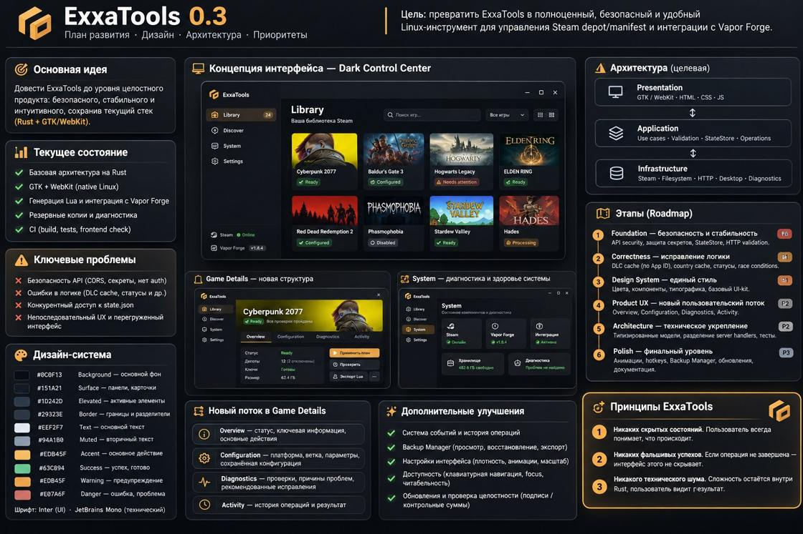
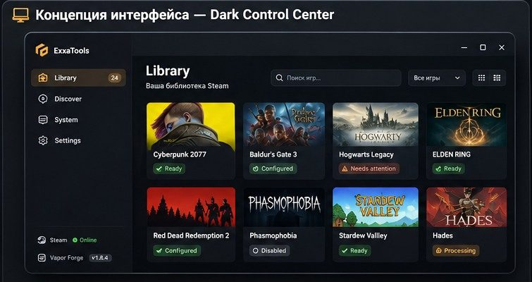
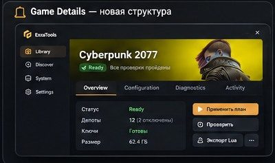
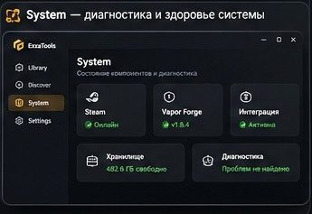

# ExxaTools 0.3 — Product hardening & interface

> **Мета:** перетворити ExxaTools на цілісний Linux desktop-продукт: безпечний, передбачуваний, візуально послідовний і простий у використанні.  
> **Підхід:** зміцнюємо наявне Rust + GTK/WebKit ядро; не переписуємо проєкт заради нового стеку.

**Статус документа:** пропозиція до плану розробки  
**Базова гілка:** `main`  
**Дата аудиту:** 12 листопада 2026 року

## 1. Візуальний напрям



Зображення — концептуальний мокап, а не скриншот реалізованої версії. Назви ігор, стани та числа на ньому демонстраційні. Його призначення — зафіксувати напрям дизайну.

### Основні принципи

- **Dark Control Center:** темний графітовий інтерфейс, акуратні поверхні й чітка типографіка.
- **Один акцент:** amber використовується для головної дії та активного стану, зелений — тільки для успіху.
- **Стан важливіший за декор:** кожна операція має зрозумілий статус, опис і наступну дію.
- **Технічна складність залишається всередині:** користувач бачить зрозумілий результат, а не сирі логи й шляхи до файлів.
- **Жодного редизайну заради редизайну:** зберігаємо Rust, GTK/WebKit та легкий frontend без важкого SPA-фреймворку.

## 2. Аудит поточного стану

### Що варто зберегти

- Rust як основне ядро, GTK/WebKit як desktop-оболонку.
- Розділення функціональності за Rust-модулями.
- Централізований рендеринг збережених планів у `lua::render_record`.
- Backup state перед записом, діагностику, self-test і CI.
- Vanilla JS у frontend: його достатньо для поточного масштабу інтерфейсу.

### Виявлені проблеми та пріоритети

| Пріоритет | Ділянка | Спостереження | Результат, якого прагнемо |
|---|---|---|---|
| **P0** | API security | Керувальні POST-запити не перевіряють Origin/Host і не вимагають токен; CORS дозволяє `*` | Запити з недовірених вебсторінок не можуть читати дані або викликати дії |
| **P0** | Секрети | `/api/status` і `/api/settings` серіалізують налаштування з ключами; `/api/app` і `/api/key` повертають сирі depot keys | API повертає лише ознаки наявності секрету, ніколи не сам секрет |
| **P0** | State persistence | Запити обробляються окремими потоками; читання → зміна → запис не є однією транзакцією | Паралельні зміни не гублять стан і не конфліктують через спільний `.tmp` |
| **P1** | DLC cache | Глобальний кеш не прив'язаний до App ID та регіону | DLC завжди відповідає відкритій грі та store-регіону |
| **P1** | Discover cache | Кеш не враховує країну магазину | Регіональні результати не змішуються |
| **P1** | Game summary | Відсутні ключі рахуються і для вимкнених depots | Покриття ключами відповідає лише активним depots |
| **P1** | Game Details | Відсутність плану може виглядати як `Keys ready` | Невідомий стан, відсутній план і готовність мають різні стани |
| **P1** | Drawer async flow | Пізня відповідь запиту може перерендерити drawer уже іншої гри | Відповідь застосовується лише до актуально відкритої гри |
| **P1** | Engine detection | Перевірка `installed` бачить наявність будь-якого файла в архітектурному каталозі, а не всіх обов'язкових бібліотек | Статус підтверджує повний комплект бібліотек для обох архітектур |
| **P1** | Depot selection | Автовибір враховує `oslist`, але потрібно повніше врахувати `osarch` | Користувач бачить причину кожного вибору та може його змінити |
| **P2** | UX | Game Details змішує огляд, DLC, виправлення, depots та експорт | Розділи з чіткою ієрархією, без перевантаження |
| **P2** | Documentation | README, DESIGN і ROADMAP місцями описують старі структури та функції | Документація відповідає поточному Rust-коду та UI |

> Цей список — статичний аудит коду `main`, а не результат повного runtime/pentest. Перед релізом усі P0/P1 пункти потрібно підтвердити автоматизованими тестами.

## 3. Цільова інформаційна архітектура

Основна навігація — чотири розділи:

| Розділ | Призначення |
|---|---|
| **Library** | Збережені ігри, пошук, фільтри та їхній поточний стан |
| **Discover** | Пошук і перегляд каталогу |
| **System** | Стан Steam, Vapor Forge, інтеграції, дисків і діагностики |
| **Settings** | Регіон, джерела даних, приватні налаштування та поведінка UI |

### 3.1 Library



Картка гри показує обкладинку, назву, App ID за потреби, стан, гілку та коротку дію. Верхня частина сторінки містить глобальний пошук і фільтри. Порожній стан має пояснювати, як додати першу гру.

Рекомендовані стани картки:

- `Not configured` — запису або конфігурації ще немає.
- `Configured` — конфігурацію збережено.
- `Needs attention` — знайдена проблема, що потребує дії.
- `Processing` — виконується операція.
- `Ready` — усі потрібні перевірки пройдено.
- `Disabled` — запис збережено, але інтеграцію вимкнено.

Статус не можна визначати лише за наявністю Lua-файлу. Він має бути результатом єдиного backend summary та перевірок.

### 3.2 Game Details



Замість довгого drawer з усіма блоками — окремі вкладки:

1. **Overview** — головний стан, короткі факти та важливі дії.
2. **Configuration** — вибрані параметри, гілка, платформа, depots і DLC.
3. **Diagnostics** — перевірки, причина проблеми та безпечна рекомендована дія.
4. **Activity** — історія операцій та їхні результати.

Розширені технічні поля можна сховати всередині відповідних секцій. Небезпечні або незворотні операції мають потребувати явного підтвердження.

### 3.3 System



Сторінка System — один достовірний огляд середовища:

- Steam: запущений/закритий, знайдений root і стан інтеграції.
- Vapor Forge: версія, комплект бібліотек, завантаження в Steam.
- Filesystem: бібліотеки Steam та доступне місце.
- Diagnostics: перевірки з коротким описом і дією.
- Activity: останні системні операції.

Усі перевірки повинні мати однакову модель: `status`, `summary`, `details`, `recommended_action`.

## 4. Дизайн-система

### Кольорові токени

| Токен | Значення | Роль |
|---|---|---|
| `--bg` | `#0C0F13` | Фон вікна |
| `--surface` | `#151A21` | Основні панелі |
| `--elevated` | `#1D242D` | Активні та підняті поверхні |
| `--border` | `#29323E` | Межі та розділювачі |
| `--text` | `#EEF2F7` | Основний текст |
| `--muted` | `#94A1B0` | Другорядний текст |
| `--accent` | `#EDB45F` | Головна дія та selected state |
| `--success` | `#63C894` | Успішний стан |
| `--warning` | `#EDB45F` | Попередження |
| `--danger` | `#E07A6F` | Помилка або небезпечна дія |

### Правила компонентів

- Шрифт UI: Inter; моноширинний — лише для технічних ідентифікаторів, manifest IDs та логів.
- Єдина шкала відступів і радіусів; один набір висот кнопок та полів.
- Primary-кнопка однаково оформлена на всіх сторінках.
- Колір завжди супроводжується текстовою міткою чи іконкою.
- Focus state помітний; повна навігація з клавіатури.
- `prefers-reduced-motion` вимикає необов'язкову анімацію.
- Loading, empty, error, success та disabled мають окремі стани.
- Для широких вікон — sidebar; на вузьких — компактна навігація без горизонтального переповнення.

## 5. Цільова архітектура

```text
Presentation
  GTK / WebKit · HTML · CSS · JavaScript
            │
            ▼
Application
  Use cases · Validation · StateStore · Operations
            │
            ▼
Infrastructure
  Steam · Filesystem · HTTP · Desktop · Diagnostics
```

### Напрямки рефакторингу

- Залишити Rust власником системного стану й операцій.
- Розділити HTTP handlers за доменами: `status`, `library`, `settings`, `diagnostics`, `system`.
- Винести читання/запис стану в єдиний `StateStore` із транзакційним API.
- Замінювати вільні `serde_json::Value` типізованими структурами там, де формат уже стабільний.
- Не дублювати обчислення стану гри у різних endpoint та frontend-компонентах.
- Винести спільні frontend-компоненти: status badge, card, empty state, alert, modal, tabs, toast.
- Усі операції повертати уніфікований результат з машинним кодом помилки та повідомленням для користувача.

## 6. План робіт

### Phase 0 — Security & state integrity

**Пріоритет: P0. До змін UI.**

- [ ] Створити публічну модель налаштувань без секретів.
- [ ] Забрати сирі depot keys з `/api/app`, `/api/key`, `/api/status` та інших звичайних відповідей.
- [ ] Повертати лише `has_key`, `has_hubcap_key`, `has_ryuu_key` та безпечні короткі метадані.
- [ ] Визначити точні дозволені Origin/Host для GTK/WebKit UI.
- [ ] Додати session/capability token для керувальних API-запитів.
- [ ] Залишити окремий автентифікований шлях для Steam CEF panel; не ламати інтеграцію без перевірки її фактичного origin.
- [ ] Прибрати wildcard CORS; дозволяти тільки необхідні origin та методи.
- [ ] Заборонити зміни стану через GET; перенести змінювальні операції на POST/DELETE.
- [ ] Встановлювати права `700` для каталогу стану та `600` для state/backups.
- [ ] Не записувати ключі, токени та їхні повні значення в логи або повідомлення про помилки.
- [ ] Захистити state read-modify-write mutex/транзакцією; зробити тимчасовий файл унікальним для запису.
- [ ] Відхиляти HTTP body понад ліміт замість мовчазного обрізання; перевіряти Content-Type та некоректні запити.

**Критерії готовності:**

- Зовнішня вебсторінка не може прочитати налаштування або викликати restart/fix.
- Жодна звичайна API-відповідь не містить сирих ключів чи токенів.
- Паралельні зміни не губляться; state завжди лишається валідним JSON.
- Автоматичні тести доводять заборону сторонніх Origin та неавторизованих мутацій.
- GTK/WebKit і Steam panel проходять окремі smoke tests після посилення API.

### Phase 1 — Correctness & diagnostics

**Пріоритет: P1.**

- [ ] Переробити DLC cache на ключ `(appid, country)` з TTL.
- [ ] Переробити Discover cache з урахуванням country та TTL.
- [ ] Не рахувати вимкнені depots як такі, що потребують ключа.
- [ ] Розвести стани `No plan`, `Keys missing`, `Ready`, `Disabled`.
- [ ] Додати request identity/cancellation для відкриття Game Details; стара відповідь не повинна міняти новий екран.
- [ ] Перевіряти `osarch` разом з `oslist`; показувати причину автовибору кожного depot.
- [ ] В Engine detection перевіряти повний список потрібних бібліотек для кожної архітектури.
- [ ] Узгодити `doctor`, `verify`, Library badge та Steam panel через одну модель стану.
- [ ] Перевірити граничні умови App ID, depot ID, manifest ID та імпорту конфігурацій.

**Критерії готовності:**

- Кеші не змішують різні ігри та регіони.
- UI не показує `Ready`, якщо план відсутній або є обов'язкові невирішені перевірки.
- Вимкнений depot не створює попередження про відсутній ключ.
- Статус Engine коректно виявляє відсутню будь-яку з обов'язкових бібліотек.
- Кожна помилка має відтворюваний тест.

### Phase 2 — Design system & navigation

**Пріоритет: P1/P2.**

- [ ] Зафіксувати дизайн-токени в одному місці.
- [ ] Уніфікувати кнопки, inputs, badges, cards, dialogs, alerts та toasts.
- [ ] Реалізувати навігацію Library / Discover / System / Settings.
- [ ] Переробити Library: статуси, фільтри, сортування, пошук, empty state.
- [ ] Переробити Game Details на Overview / Configuration / Diagnostics / Activity.
- [ ] Перенести глобальні діагностики й quick actions на System.
- [ ] Зробити Settings повноцінною сторінкою або послідовною панеллю з категоріями.
- [ ] Перевірити ширини 620, 900, 1080 та великі desktop-вікна.
- [ ] Перевірити контраст, focus, keyboard flow та reduced motion.

**Критерії готовності:**

- У всіх сторінок однакова візуальна мова.
- На першому екрані немає сирих логів, довгих шляхів чи технічних полів без потреби.
- Користувач може дістатися до кожної основної дії клавіатурою.
- На вузькому вікні контент не обрізається й не створює горизонтальний скрол.

### Phase 3 — User flows

**Пріоритет: P2.**

- [ ] Зробити покроковий Add Game flow: Game → Configuration → Review → Apply.
- [ ] Зберігати прогрес кроків при переході назад/вперед.
- [ ] Показувати зрозуміле покриття configuration data до застосування.
- [ ] Розділити збереження конфігурації та її застосування.
- [ ] Додати явний підсумок операції: що змінилося, що не виконано і чому.
- [ ] Уніфікувати confirmation для restart, remove та інших дій із побічними ефектами.
- [ ] Додати Activity timeline з часом, типом операції, результатом і деталями.

**Критерії готовності:**

- Основний сценарій проходиться без термінала.
- Користувач бачить підсумок до підтвердження та після операції.
- Часткова невдача не маскується повідомленням про повний успіх.

### Phase 4 — Architecture, tests & release polish

**Пріоритет: P2.**

- [ ] Розбити `server.rs` на доменні handlers без дублювання бізнес-логіки.
- [ ] Ввести типізовані DTO для API та стабільних записів state.
- [ ] Додати інтеграційні тести з тимчасовими Steam library/state fixtures.
- [ ] Додати API security regression tests.
- [ ] Додати перевірки frontend interactions для drawer, tabs, forms та loading/error states.
- [ ] Посилити CI: `cargo fmt --check`, `cargo clippy -- -D warnings`, `cargo test --locked`, `node --check`, selftest.
- [ ] Оновити README, DESIGN, ROADMAP та опис структури репозиторію.
- [ ] Переглянути packaging: прибрати `sha256sums=('SKIP')`, зафіксувати контрольну суму релізного архіву.
- [ ] Для engine updates перевіряти завантаження за довіреним release digest/signature, якщо upstream це надає.
- [ ] Підготувати release checklist та rollback instructions.

**Критерії готовності:**

- Нові фічі не вимагають додавання логіки у великий монолітний handler.
- Критичні потоки мають регресійні тести.
- Документація описує саме той код, що лежить у `main`.
- Пакет збирається й проходить smoke test на чистому Arch Linux середовищі.

## 7. Матриця тестування

| Зона | Мінімальні перевірки |
|---|---|
| API security | сторонній Origin, невалідний token, CORS preflight, Host mismatch, GET mutation |
| Secrets | status/settings/app/key responses не містять секретів; логи не містять секретів |
| State | одночасне збереження, пошкоджений JSON, backup, atomic replace, права файлів |
| Cache | різні App ID, різні country, TTL expiry, upstream failure |
| Game state | no plan, missing keys, disabled depots, partial configuration, ready |
| Drawer/UI | повільний запит старої гри, швидке перемикання, закриття під час завантаження |
| Engine | усі бібліотеки є, відсутня одна бібліотека, часткова інсталяція, checksum mismatch |
| Layout | вузьке/широке вікно, keyboard-only, reduced motion, довгі назви |
| Release | clean build, tests, selftest, package install, launch, uninstall/rollback |

## 8. Правила виконання

1. Одна задача — один зрозумілий commit або невеликий PR.
2. Спочатку тест, який відтворює проблему; потім виправлення.
3. Не змішувати в одному PR security refactor та косметичний редизайн.
4. Не змінювати формат `state.json` без backward-compatible migration та backup test.
5. Не додавати новий великий framework, якщо задача розв'язується невеликою абстракцією.
6. Кожен action у UI має мати pending, success і failure state.
7. Не показувати секрети користувача ні в UI, ні в логах, ні в export за замовчуванням.
8. Розробляти й тестувати інтеграції лише в межах даних та операцій, до яких користувач має законний доступ.

## 9. Рекомендований порядок перших задач

| Порядок | Задача | Чому першою |
|---:|---|---|
| 1 | Sanitized settings/status DTOs | Найшвидше прибирає витік секретів через API |
| 2 | Origin/Host + session token + CORS policy | Закриває довіру до локального control API |
| 3 | StateStore transaction boundary | Захищає ключі та конфігурації від race conditions |
| 4 | Cache keys + disabled depot accounting | Виправляє конкретні неправильні результати |
| 5 | Engine completeness checks | Не дозволяє показувати неправдивий installed state |
| 6 | Shared frontend status model | Знімає суперечності між Library, Game та System |
| 7 | Design tokens + navigation shell | Дає основу для безпечного редизайну екранів |

## 10. Definition of Done для ExxaTools 0.3

Реліз можна вважати готовим, коли:

- [ ] P0 security issues закриті й захищені тестами.
- [ ] State не губиться при паралельних запитах.
- [ ] Кеші та стани гри не змішують записи.
- [ ] Library, Game Details, System і Settings мають єдиний дизайн.
- [ ] Основні сценарії зрозумілі без читання технічної документації.
- [ ] Усі критичні стани мають пояснення й коректну дію.
- [ ] CI, selftest і чисте пакування проходять.
- [ ] README та документація синхронізовані з реалізацією.

---

## Джерела для реалізації

- [README.md](../README.md)
- [DESIGN.md](../DESIGN.md)
- [ROADMAP.md](../ROADMAP.md)
- [src/server.rs](../src/server.rs)
- [src/state.rs](../src/state.rs)
- [src/steam.rs](../src/steam.rs)
- [src/doctor.rs](../src/doctor.rs)
- [src/verify.rs](../src/verify.rs)
- [web/index.html](../web/index.html)
- [web/app.js](../web/app.js)
- [web/style.css](../web/style.css)
- [packaging/PKGBUILD](../packaging/PKGBUILD)
